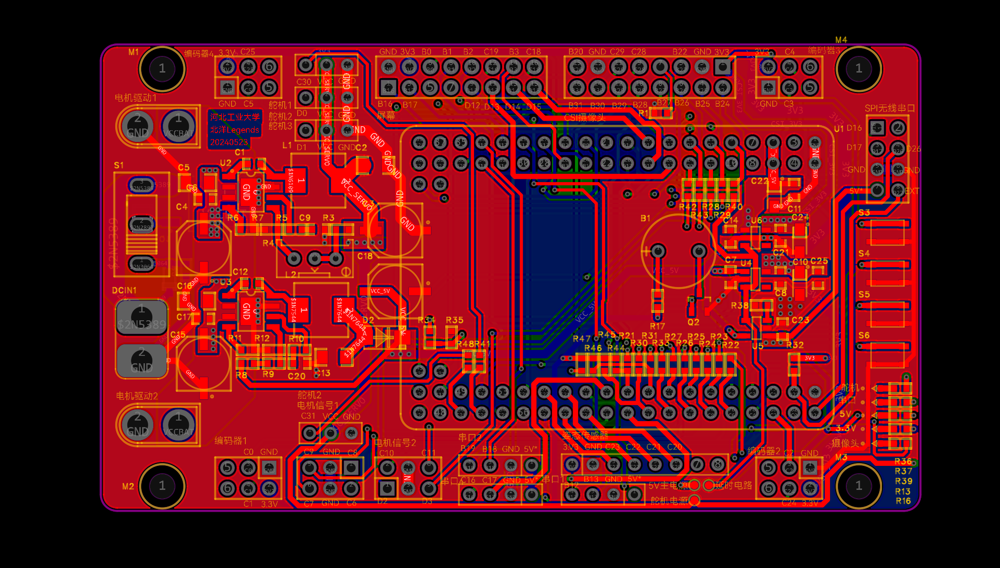
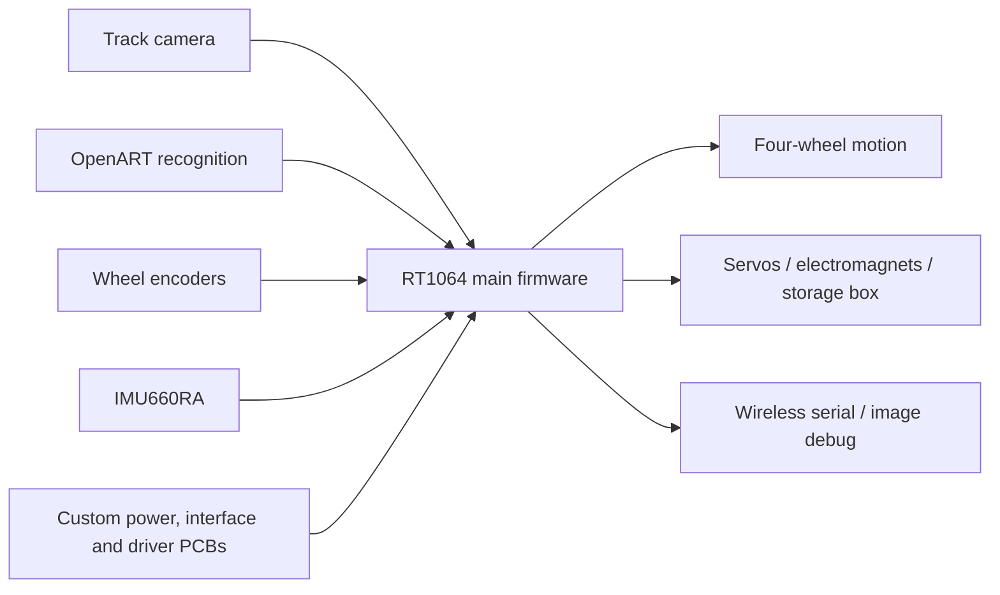
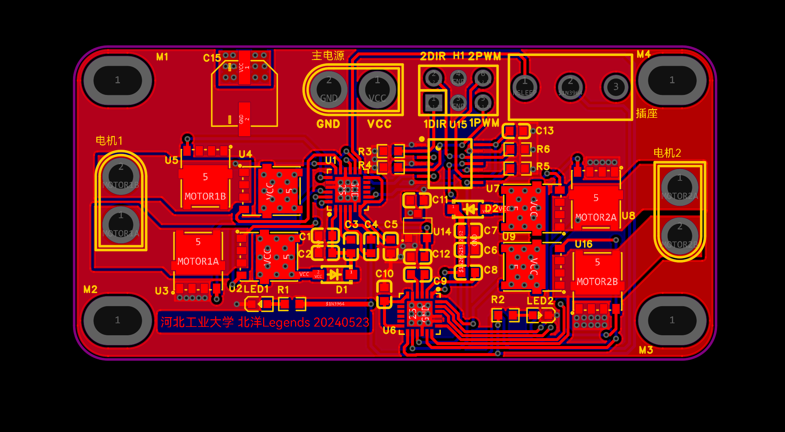
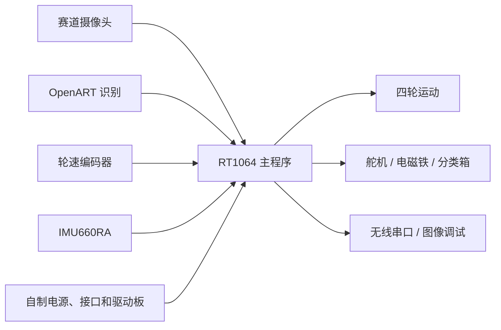

# Smart Car Vision Platform

RT1064 firmware, OpenART scripts, PCB design files, IMU notes, and field bring-up records from our project for the 19th National Undergraduate Smart Car Competition, Vision Group. The team received a regional Second Prize.

The task combined autonomous driving with target-board detection, classification, transport, and placement. Getting the car to complete that chain required the main controller, track camera, OpenART recognition modules, four-mecanum-wheel chassis, encoder/IMU feedback, servo and electromagnet mechanisms, and custom PCBs to work as one system.

## Competition Task

The car starts from the designated area and uses the track as a ground-guidance map. It must find target boards placed beside the track or stacked around ring/cross-loop areas, identify their category, and move them to the corresponding placement zones.

The resulting engineering chain is:

1. stabilize four-wheel motion and track following;
2. locate a target board and approach it;
3. classify it through OpenART;
4. map recognition output into mission and storage-box states;
5. actuate motors, servos, and electromagnets to collect and place the board;
6. use encoders, IMU feedback, serial logs, and repeated field tests to tune the complete vehicle.

See [docs/competition-task.md](docs/competition-task.md) for the 19th Vision Group context and its mapping to this repository.

## System Overview

## Repository Map

| Path | Contents |
|---|---|
| `firmware/rt1064/project/code/` | Main control modules for motion, tracking, mission state, encoders, motors, servos, IMU, UART, filtering, card/box logic, and debugging. |
| `firmware/openart/` | OpenART runtime and deployment scripts plus label files. These Python files run on the vision module; they are not desktop simulation code. |
| `hardware/pcb/` | EasyEDA Pro projects and schematic/PCB exports for the competition-stage boards. |
| `hardware/imu/` | IMU660RA configuration and tuning notes. |
| `docs/bringup-log.md` | A chronology of PID tuning, path tracking, OpenART integration, ring logic, servo behavior, and board bring-up. |
| `docs/openart-vision.md` | OpenART modes, serial protocol, labels, and deployment workflow. |
| `docs/hardware.md` | Board interfaces and electrical notes. |
| `docs/system-architecture.md` | Control and data-flow diagram. |
| `docs/contribution-scope.md` | Team roles and reuse notes. |

## Firmware And Hardware Notes

The repository preserves the competition-stage application code and MDK project metadata. Building the RT1064 firmware requires the board support package, startup files, compiler configuration, and peripheral libraries that match the original development board.

The PCB files are design snapshots from the competition iteration. They are useful for reviewing power distribution, connectors, interfaces, and driver-board evolution, but they should receive a fresh electrical-rule, footprint, connector-label, and manufacturing review before another fabrication run.

## Team

The vehicle and competition result were produced by the full team.

| Member | Main contribution |
|---|---|
| 戴哲维 | Main program and RT1064 vehicle-control firmware. |
| 葛洪飞 | Main program and RT1064 vehicle-control firmware. |
| 黄得时 | Mechanical structure and mechanism work. |
| 么林坤 | Vision system and OpenART recognition work. |
| 田秉卓 | PCB design, soldering, board iteration, and hardware bring-up support; maintains this repository. |

## License And Reuse

This is a mixed-authorship team project. The root Apache-2.0 license applies only to material whose author has granted that license. Firmware, vision code, mechanical work, and PCB artifacts retain their respective authorship. See [LICENSE_SCOPE.md](LICENSE_SCOPE.md) and [NOTICE](NOTICE).

---

# 中文说明

本仓库整理的是第十九届全国大学生智能汽车竞赛视觉组项目中的 RT1064 固件、OpenART 脚本、PCB 设计、IMU 笔记和实车调试记录。团队获区域赛二等奖。

赛题把自主行驶、目标板检测与分类、搬运和放置连成一条完整任务链。要让它在实车上运行，需要 RT1064 主控、赛道摄像头、OpenART 识别模块、四麦轮底盘、编码器/IMU 反馈、舵机和电磁铁机构，以及自制 PCB 协同工作。

## 赛题任务

车辆从指定区域出发，以赛道作为地面引导，在赛道旁和圆环/十字区域寻找散落或堆叠的目标板，识别类别后搬运到对应放置区。

工程链路可以概括为：

1. 稳定四轮运动和赛道循迹；
2. 搜索目标板并完成近距离接近；
3. 通过 OpenART 完成分类；
4. 把识别结果映射到任务状态和分类箱逻辑；
5. 控制电机、舵机和电磁铁完成取放；
6. 结合编码器、IMU、串口日志和现场测试反复联调。

详细背景见 [docs/competition-task.md](docs/competition-task.md)。

## 系统结构

## 仓库结构

| 路径 | 内容 |
|---|---|
| `firmware/rt1064/project/code/` | 运动、循迹、任务状态、编码器、电机、舵机、IMU、串口、滤波、卡片/分类箱和调试模块。 |
| `firmware/openart/` | OpenART 运行与部署脚本、标签文件。这些 Python 文件运行在视觉模块上，不是后来添加的桌面仿真。 |
| `hardware/pcb/` | 竞赛阶段的嘉立创 EDA Pro 工程、原理图和 PCB 导出。 |
| `hardware/imu/` | IMU660RA 配置和调参记录。 |
| `docs/bringup-log.md` | PID、循迹、OpenART、圆环逻辑、舵机和板级调试时间线。 |
| `docs/openart-vision.md` | OpenART 模式、串口协议、标签和部署流程。 |
| `docs/hardware.md` | 板卡接口和电气说明。 |
| `docs/system-architecture.md` | 控制与数据流。 |
| `docs/contribution-scope.md` | 团队分工与复用说明。 |

## 固件与 PCB 说明

仓库保留竞赛阶段的应用层代码和 MDK 工程元数据。编译 RT1064 固件还需要与原开发板匹配的板级支持包、启动文件、编译器配置和外设库。

PCB 文件记录了竞赛阶段的设计迭代。它们可以用于复盘配电、接口和驱动板演变，但再次打样前仍应重新执行电气规则、封装、连接器标注和可制造性检查。

## 团队分工

整车和竞赛成绩由团队共同完成。

| 成员 | 主要贡献 |
|---|---|
| 戴哲维 | 主程序与 RT1064 整车控制固件。 |
| 葛洪飞 | 主程序与 RT1064 整车控制固件。 |
| 黄得时 | 机械结构与机构相关工作。 |
| 么林坤 | 视觉系统与 OpenART 识别。 |
| 田秉卓 | PCB 设计、焊接、板级迭代和硬件联调支持；维护本仓库。 |

## 许可与复用

这是多人署名的团队项目。根目录 Apache-2.0 只适用于作者确实授予该许可的材料；固件、视觉代码、机械工作和 PCB 文件分别保留对应作者的权利。详见 [LICENSE_SCOPE.md](LICENSE_SCOPE.md) 和 [NOTICE](NOTICE)。
