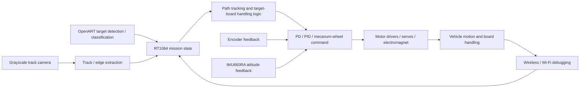
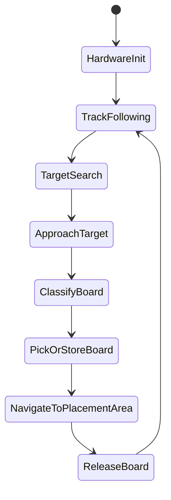

# System Architecture

This page shows how the pieces of our car fit together. The diagrams below are the actual control chain we ended up with — it evolved quite a bit from what we originally planned, as these things tend to do.

## Task-Driven Flow

The 19th Vision Group task shaped the whole system as one integrated chain. Here's what the car actually needs to do, step by step:

1. Follow the track to reach useful search areas.
2. Detect scattered or stacked target boards.
3. Classify target boards through OpenART recognition.
4. Move the four-mecanum-wheel chassis to pick or place boards.
5. Use encoder and IMU feedback to keep speed, heading, and translation stable.
6. Use wireless/Wi-Fi debugging during bring-up, then keep official-run configuration compliant.

The state machine below shows how the mission logic flows during a run:

In practice, the transitions between these states were messier than the diagram suggests — there was a lot of back-and-forth between target search and approach, and the "pick or store" step took quite a few iterations to get right.

## Notes

- OpenART provides target-board detection and classification results to the RT1064 control logic.
- The RT1064 firmware combines track-camera input, OpenART recognition output, encoder feedback, IMU attitude feedback, and mission state to generate motor, servo, and handling commands.
- The main program work was mainly handled by 戴哲维 and 葛洪飞; the vision part was mainly handled by 么林坤; mechanical structure was mainly handled by 黄得时; PCB design and soldering were mainly handled by 田秉卓.
- For a future ROS 2 version, recognition output can be treated as a topic, the controller as a node, and the motor/servo/electromagnet outputs as actuator interfaces.

---

# 中文版本

# 系统架构

这个页面展示的是我们小车各个模块是怎么拼到一起的。下面的图是实际跑通之后的控制链路——跟我们最初计划的差别还挺大的，不过事情总是这样的。

## 任务驱动的流程

第十九届视觉组的任务把整个系统塑造成了一个完整的链路。下面是小车实际要做的事情，一步一步来：

1. 沿赛道行驶，到达有用的搜索区域。
2. 检测散落或堆叠的目标板。
3. 通过 OpenART 识别对目标板进行分类。
4. 控制四麦轮底盘去拣取或放置目标板。
5. 利用编码器和 IMU 反馈保持速度、航向和平移的稳定。
6. 调试阶段用无线/Wi-Fi 调参，正式运行时保持配置合规。

下面的状态机展示了运行过程中任务逻辑的流程：

实际上，这些状态之间的切换比图里画的要乱得多——目标搜索和靠近之间经常来回跳，"拣取或暂存"这一步也是迭代了好多次才稳定下来。

## 补充说明

- OpenART 向 RT1064 控制逻辑提供目标板检测和分类结果。
- RT1064 固件把赛道摄像头输入、OpenART 识别输出、编码器反馈、IMU 姿态反馈和任务状态合在一起，生成电机、舵机和搬运指令。
- 主程序工作主要由戴哲维和葛洪飞负责；视觉部分主要由么林坤负责；机械结构主要由黄得时负责；PCB 设计和焊接主要由田秉卓负责。
- 如果将来做 ROS 2 版本的话，识别输出可以当话题处理，控制器当节点，电机/舵机/电磁铁输出当执行器接口。
